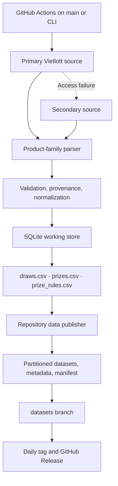

# Vietlott Data Collector architecture

## Components

- `config.py`: product catalog, endpoints, number ranges, and page sizes.
- `http.py`: sessions, retries, backoff, `Retry-After`, rate limits, and jitter.
- `sources/`: the official Vietlott source and secondary sources used when needed.
- `parsers/`: converts HTML and Ajax responses into `DrawRecord` and `PrizeRecord` objects.
- `validation.py`: checks counts, value ranges, duplicate numbers, and prize structure.
- `provenance.py`: records sources, verification levels, and allowed status transitions.
- `storage.py`: stable-key upserts, SQLite storage, and CSV/Parquet export.
- `incremental_update.py`: scheduled updates, recent-history reconciliation, and fallbacks.
- `full_backfill.py`, `keno_history.py`, `keno_gap_repair.py`: historical collection and evidence-based gap repair.
- `repository_data.py`: hydrates, publishes, validates, and audits repository snapshots.
- `quality.py` and `audit.py`: check completeness, duplicate keys, schemas, sources, and file sizes.
- Workflows run the collector from `main`, write valid snapshots to `datasets`, and publish a daily tag after the final run succeeds.

## Invariants

- Sources determine which draws exist. Schedules only determine when to check.
- Never infer the next draw ID or interpolate a missing result.
- Upserts do not create duplicate records or remove records whose confirmation was withdrawn.
- Secondary sources do not overwrite official records without an explicit reconciliation rule.
- Every data change goes through `publish` and `validate`.
- Metadata is regenerated from the snapshot and is never edited by hand to change reported values.

## Extending the collector

Add a `ProductSpec` in `config.py`, parser fixtures, and matching data coverage. If `DrawRecord` and `PrizeRecord` already contain the required fields, the storage layer does not need to change.
